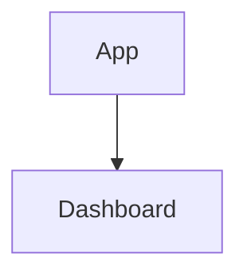

# CodeDolphin Architecture

## System Overview

```
┌─────────────────────────────────────────────────────────────────┐
│                         Developer                               │
│                    (Pushes code to GitHub)                      │
└────────────────────────────┬────────────────────────────────────┘
                             │
                             ▼
┌─────────────────────────────────────────────────────────────────┐
│                          GitHub                                 │
│  ─────────────────────────────────────────────────────────      │
│  • Stores PR data                                               │
│  • Generates diff                                               │
│  • Triggers webhook → POST /api/webhooks/github                 │
└────────────────────────────┬────────────────────────────────────┘
                             │
                             │ HTTP POST
                             │ { action: "opened", pull_request: {...} }
                             ▼
┌─────────────────────────────────────────────────────────────────┐
│              CodeDolphin (Next.js App)                          │
│  ─────────────────────────────────────────────────────────      │
│                                                                  │
│  ┌──────────────────────────────────────────────────────────┐  │
│  │  Webhook Handler                                         │  │
│  │  (app/api/webhooks/github/route.ts)                      │  │
│  │  • Verify signature ✓                                    │  │
│  │  • Parse payload ✓                                       │  │
│  │  • Start processing ✓                                    │  │
│  └────────────────────┬─────────────────────────────────────┘  │
│                       │                                          │
│                       ▼                                          │
│  ┌──────────────────────────────────────────────────────────┐  │
│  │  GitHub Client                                           │  │
│  │  (lib/github/client.ts)                                  │  │
│  │  • Fetch changed files via Octokit                       │  │
│  │  • Get full file content                                 │  │
│  │  • Filter .ts/.tsx/.js/.jsx files                        │  │
│  └────────────────────┬─────────────────────────────────────┘  │
│                       │                                          │
│                       ▼                                          │
│  ┌──────────────────────────────────────────────────────────┐  │
│  │  AST Parser                                              │  │
│  │  (lib/analyzer/parser.ts)                                │  │
│  │  • Parse code to Abstract Syntax Tree                    │  │
│  │  • Uses @typescript-eslint/typescript-estree             │  │
│  │  • Handles TS/JS/JSX/TSX                                 │  │
│  └────────────────────┬─────────────────────────────────────┘  │
│                       │                                          │
│                       ▼                                          │
│  ┌──────────────────────────────────────────────────────────┐  │
│  │  Static Analysis Engine                                  │  │
│  │  (lib/analyzer/index.ts)                                 │  │
│  │                                                           │  │
│  │  ┌─────────────────────────────────────────────────┐    │  │
│  │  │  Rule 1: Hook Dependencies                      │    │  │
│  │  │  • Check useEffect/useCallback/useMemo          │    │  │
│  │  │  • Find missing dependencies                    │    │  │
│  │  └─────────────────────────────────────────────────┘    │  │
│  │                                                           │  │
│  │  ┌─────────────────────────────────────────────────┐    │  │
│  │  │  Rule 2: Server/Client Boundaries               │    │  │
│  │  │  • Detect hooks in Server Components            │    │  │
│  │  │  • Detect browser APIs in Server Components     │    │  │
│  │  └─────────────────────────────────────────────────┘    │  │
│  │                                                           │  │
│  │  ┌─────────────────────────────────────────────────┐    │  │
│  │  │  Rule 3: Image Optimization                     │    │  │
│  │  │  • Check for  vs next/image                │    │  │
│  │  │  • Verify alt attributes                        │    │  │
│  │  └─────────────────────────────────────────────────┘    │  │
│  │                                                           │  │
│  │  Output: Issue[] with line numbers & suggestions         │  │
│  └────────────────────┬─────────────────────────────────────┘  │
│                       │                                          │
│                       ▼                                          │
│  ┌──────────────────────────────────────────────────────────┐  │
│  │  LLM Integration                                         │  │
│  │  (lib/llm/summary-generator.ts)                          │  │
│  │                                                           │  │
│  │  ┌─────────────────────────────────────────────────┐    │  │
│  │  │  OpenAI GPT-4o-mini                             │    │  │
│  │  │  • Generate human-readable summary              │    │  │
│  │  │  • Create Mermaid architecture diagram          │    │  │
│  │  │  • Explain issues in context                    │    │  │
│  │  └─────────────────────────────────────────────────┘    │  │
│  │                                                           │  │
│  │  Output: { summary, diagram, score }                     │  │
│  └────────────────────┬─────────────────────────────────────┘  │
│                       │                                          │
│                       ▼                                          │
│  ┌──────────────────────────────────────────────────────────┐  │
│  │  Comment Formatter                                       │  │
│  │  (lib/github/comment-formatter.ts)                       │  │
│  │  • Format as beautiful markdown                          │  │
│  │  • Add score emoji (🟢🟡🟠🔴⛔)                          │  │
│  │  • Include diagram & detailed issues                     │  │
│  └────────────────────┬─────────────────────────────────────┘  │
│                       │                                          │
│                       ▼                                          │
│  ┌──────────────────────────────────────────────────────────┐  │
│  │  GitHub Client                                           │  │
│  │  (lib/github/client.ts)                                  │  │
│  │  • Post comment to PR via Octokit                        │  │
│  └──────────────────────────────────────────────────────────┘  │
│                                                                  │
└────────────────────────────┬────────────────────────────────────┘
                             │
                             │ POST comment
                             ▼
┌─────────────────────────────────────────────────────────────────┐
│                          GitHub                                 │
│  • Comment appears on PR                                        │
│  • Developer sees review                                        │
└─────────────────────────────────────────────────────────────────┘
```

## Data Flow

### 1. Input (GitHub Webhook)
```json
{
  "action": "opened",
  "pull_request": {
    "number": 42,
    "title": "Add new feature",
    "head": { "sha": "abc123" },
    "base": { "sha": "def456" }
  },
  "repository": {
    "full_name": "owner/repo"
  }
}
```

### 2. Fetched Files
```typescript
[
  {
    filename: "components/Dashboard.tsx",
    content: "import React...",
    patch: "@@ -10,5 +10,6 @@...",
    additions: 15,
    deletions: 3
  }
]
```

### 3. Parsed AST
```typescript
{
  type: "Program",
  body: [
    {
      type: "ImportDeclaration",
      source: { value: "react" }
    },
    {
      type: "ExportDefaultDeclaration",
      declaration: {
        type: "FunctionDeclaration",
        // ... nested AST nodes
      }
    }
  ]
}
```

### 4. Detected Issues
```typescript
[
  {
    id: "hook-deps-45",
    rule: "react-hooks/exhaustive-deps",
    severity: "error",
    message: "Missing dependencies: userId",
    filename: "components/Dashboard.tsx",
    line: 45,
    column: 10,
    suggestion: "Add [userId] to dependency array"
  }
]
```

### 5. LLM Output
```typescript
{
  score: "C",
  summary: "Found 3 critical issues that should be addressed...",
  diagram: "graph TD\n  A[App] --> B[Dashboard]\n  style B fill:#f66"
}
```

### 6. Final Comment (Markdown)
```markdown
## 🐬 CodeDolphin Review

### Overall Score: 🟠 **C**

Found 3 critical issues...

### 📊 Architecture Overview


### 🔍 Issues Found (3)
...
```

## Technology Stack

### Core
- **Next.js 16**: App Router, API Routes
- **TypeScript**: Type safety
- **React 19**: Latest features

### Analysis
- **@typescript-eslint/typescript-estree**: AST parsing
- **Custom Rules**: Pattern matching on AST

### AI
- **LangChain**: LLM orchestration
- **OpenAI GPT-4o-mini**: Cost-effective AI model

### GitHub
- **@octokit/rest**: GitHub API client
- **@octokit/webhooks**: Webhook verification

### Future (Week 2+)
- **Prisma**: Database ORM
- **PostgreSQL**: Data persistence
- **Better Auth**: Authentication
- **Inngest**: Background job queue

## Performance Characteristics

| Operation | Time | Cost |
|-----------|------|------|
| Webhook verification | <10ms | $0 |
| Fetch files (5 files) | ~500ms | $0 |
| Parse to AST | ~100ms | $0 |
| Static analysis | ~50ms | $0 |
| LLM summary | ~2-3s | $0.001 |
| Post comment | ~200ms | $0 |
| **Total** | **~4-5s** | **$0.001** |

## Scalability

### Current (Week 1)
- **Concurrent PRs**: 1 (synchronous)
- **Max throughput**: ~12 PRs/minute
- **Bottleneck**: LLM API calls

### Future (Week 3+)
- **Concurrent PRs**: 10+ (with Inngest)
- **Max throughput**: ~100 PRs/minute
- **Bottleneck**: GitHub API rate limits

## Security

### Current
- ✅ Webhook signature verification
- ✅ Environment variables for secrets
- ❌ No authentication (Week 2)
- ❌ No rate limiting (Week 3)

### Future
- GitHub OAuth
- Per-user API keys
- Rate limiting per repository
- Audit logs

---

**Architecture Status**: Week 1 Complete ✅
